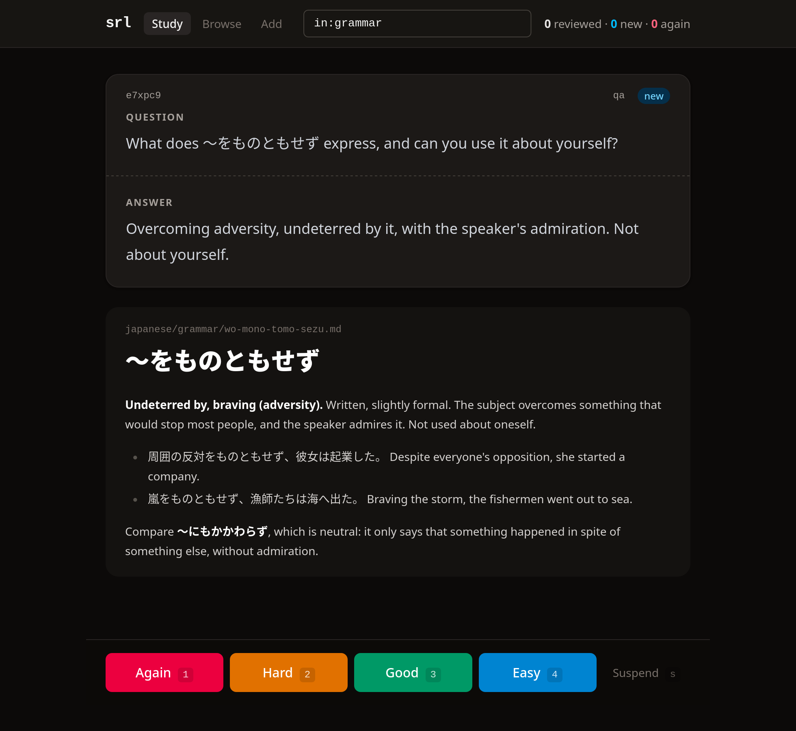
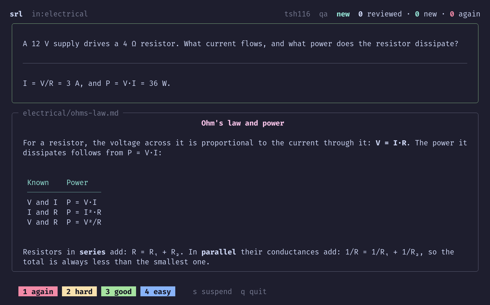

# srl

A programmable data layer for spaced repetition.

`srl` keeps your questions inside your Markdown notes (or, when programs
write them, in JSONL files of their own) and your reviews in a
plain-text log, schedules every card with
[FSRS](https://github.com/open-spaced-repetition/fsrs4anki/wiki/ABC-of-FSRS),
and exposes all of it through a CLI with JSON output. It has no study screen
of its own. Instead, it is the one place where your study data lives and
stays correct, and everything else is built on top: web and terminal
frontends, shell scripts, importers, kind programs that make new types of
cards, and any other tool you write.

```
          you, your editor, scripts, importers
                │ write notes        ▲ read JSON
                ▼                    │
 ┌─────────────────────────────────────────────────────┐
 │  srl: notes + review log → FSRS → the next card     │
 │  every command non-interactive, every output JSON   │
 └─────────────────────────────────────────────────────┘
                │ srl next --json    ▲ srl review
                ▼                    │
     any frontend: web, terminal, a shell loop, …
```

## Why a data layer

Spaced repetition apps bundle three things: your cards, the scheduler, and
the screen you study on. You can't easily generate cards with a script,
study in a different interface, or analyze what you keep forgetting with
your own tools, because the data is locked inside the app.

`srl` keeps only the part that has to be right: the data and the schedule.
Everything else is a separate program, so it can be replaced, rewritten or
built by you.

- **The CLI is the API.** Every command is non-interactive, with JSON
  output. Frontends and scripts use the same commands you do; there
  is no separate interface to learn.
- **Small fixed contracts.** The item syntaxes, the card, the frontend
  contract (`srl next --json`), the review event and the selector language
  are rigid and documented, so the programs around them can vary freely.
- **One schedule for everyone.** Frontends never compute schedules. Study
  in the browser in the morning and in a terminal at night, and it's the
  same queue.
- **Plain text all the way down.** Items are lines in your notes; reviews
  are lines in append-only JSONL files. `cat`, `grep`, git and any program
  that reads files can work with them. The SQLite index is only a cache.
- **New types of cards are programs.** Beside questions and answers with
  cloze deletions, a kind of card can be a program you write in any
  language: conjugation drills, words of a sentence, problems drawn at
  random. `srl` schedules their cards like any other.

## Your data: questions inside your notes

````markdown
# 食い倒れ

Eating yourself into ruin. Osaka's motto, lived nightly along Dotonbori:
京の着倒れ、大阪の食い倒れ (Kyoto spends it on clothes, Osaka on food).

```srl
@ id:x7k2m9
Q: What does 食い倒れ mean?
A: Eating until you drop, or go broke.

@ id:p4n8d2
Q: 道頓堀で{{c1::食い倒れ}}の一日を過ごした。
```
````

That's a complete note with two cards in it. The questions live in a
fenced `srl` block, so the note stays a normal Markdown file for your
editor, your viewer or GitHub, which show the block as code; a block can
also hold a single question, with its ID on the fence (```` ```srl
id:x7k2m9 ````). When you study a card, the note around it is shown as
context after the answer.

Questions that scripts write can go in a JSONL note instead,
one JSON object per line, each naming the note it asks about with `see`:

```json
{"id": "q8m2k1", "see": "japanese/vocabulary/osaka.md", "Q": "What does 食い倒れ mean?", "A": "Eating yourself into ruin."}
```

A JSONL note holds nothing but items, and has no context of its own, so
each item names its note with `see`. `srl add` and `srl edit` take items
in that same form, whatever note they go to, and `srl id` gives IDs to the
lines that have none. JSONL notes are read once your configuration names
them, in `.srl/config.toml`:

```toml
[notes]
include = ["**/*.md", "**/*.jsonl"]
```

A card's identity is its ID, so you can reword a question or move its note
without losing its schedule. Your folders are your topics:
`srl next in:grammar` studies every note under a `grammar` folder.

## What you can build on it

### Frontends

A frontend is any program that calls `srl next --json` and records ratings
with `srl review`. It knows nothing about notes, kinds or cloze syntax, so
any frontend can show any card. This shell loop is a complete one:

```sh
while card=$(srl next in:grammar --json); do
  jq -r .prompt <<<"$card"; read -r _
  jq -r '.prompt_revealed // .prompt, .answer // empty, "---", .context // empty' <<<"$card"; read -r -p 'rating 1-4: ' r
  jq -n --argjson card "$card" --argjson rating "$r" '{card: $card.id, rating: $rating}' | srl review --stdin
done
```

The repository has two fuller ones to start from: `srl-web`, a local web
viewer with a card browser and a form for adding items to any note,
Markdown or JSONL, and `srl-tui`, a terminal frontend in Python.

> **Note:** `srl` doesn't include a frontend in its core. These two are
> ready-to-use examples that ship with the repository, in
> [examples/](examples/), to use as they are or to change.

`srl-web`, with the answer of a card revealed and the ratings below it:



`srl-tui`, on a card about Ohm's law:



### Kinds: cards made by your own programs

An item's kind decides how its fields become cards. `qa`, questions and
answers with cloze deletions, is built in. Any other kind is a program you
name in `.srl/config.toml`, written in any language:

```toml
[kinds]
ja-words = ["python3", "kinds/ja_words.py"]
```

A kind checks its items, says which cards each gives and which of them
give each other away, and makes each card's content when it is shown, so
it can do anything a program can: conjugate a verb, look a word up in a
dictionary, draw a new arithmetic problem each time. The repository has
two examples: `ja-words` makes one card per marked word of a Japanese
sentence, and `llm-generated` asks an LLM to write a new question about a
topic every time the card is shown, while `srl` keeps scheduling it as one
card.

### Scripts and analysis

Selectors such as `in:rust -state:new` or `state:leech` work the same in
every command, and every command prints JSON with `--json`. Reports,
imports, bulk edits and dashboards are a few lines of shell or any other
language away. Shells built around structured data can work with it
directly: [examples/nushell/](examples/nushell/) is a Nushell wrapper
whose commands give tables and records to filter with `where` and
`sort-by`.

### LLM agents

`srl` knows nothing about agents: an agent is one more program built on
the CLI, and works with a store the way a person does, running commands
and writing notes. It can turn a note or an article into questions, sent as
JSONL and kept as drafts until you accept them:

```sh
srl add generated/japanese.md --stdin <<'JSONL'
{"see": "japanese/grammar/wo-mono-tomo-sezu.md", "draft": true, "Q": "Make a sentence with 〜をものともせず about a football team.", "A": "…"}
{"see": "japanese/grammar/wo-mono-tomo-sezu.md", "draft": true, "Q": "{{c1::嵐}}をものともせず、漁師たちは海へ出た。"}
JSONL
srl accept path:generated/japanese.md   # after you've read them
```

The same lines can go to a JSONL note instead, `srl add
generated/japanese.jsonl --stdin`, where each item is stored as one line,
just as it was sent. There is then no Markdown for the agent to get
wrong, such as the fences around a field that holds code, and the note
stays easy to read and change with `jq`.

It can also be your frontend, tutoring you in a chat: it takes the next
card, judges your answer in your own words, and records the rating with
`srl review --by agent`. And it can read `srl stats`, `srl log` and
`srl find state:leech` to find what you keep forgetting and propose
rewrites. Giving an agent only a few tools, each running one `srl` command,
keeps it from doing anything `srl` wouldn't accept.

## Predictable by design

One simple rule per decision, no hidden state, and errors that say what to
do about them. A broken note stops `srl` loudly instead of being silently
skipped, so the programs built on it can trust what they read.

## Install

```sh
cargo install srl
```

`srl` works on Linux, macOS and Windows.

## Quick start

```sh
srl init ~/notes          # make a folder of notes into a store
cd ~/notes
$EDITOR rust/ownership.md # write an item: ```srl, Q: and A: lines, then ```
srl id                    # give new items their IDs
srl next                  # the next card to study (frontends use srl next --json)
srl review ID --rating 3  # rate it: 1 Again, 2 Hard, 3 Good, 4 Easy
srl stats                 # what's new, due, young, mature
```

To add items without writing Markdown, send them as JSON lines to a JSONL
note (once `include` names `*.jsonl`, see above), or to a Markdown note,
where `srl` writes the srl blocks for you:

```sh
echo '{"see": "rust/ownership.md", "Q": "Can a moved value be used again?", "A": "No."}' \
  | srl add inbox.jsonl --stdin
```

Cloze deletions use Anki's syntax (`{{c1::text}}` and `{{c1::text::hint}}`).
Multi-line fields, code blocks and drafts are supported too. `srl kinds`
describes every kind and its fields.

## Examples

The repository's [examples/](examples/) are built on `srl` and are not part
of it: copy them and change them.

| Example | What it is |
|---|---|
| [`web-frontend/`](examples/web-frontend/) | `srl-web`: a local web viewer that renders cards and context as Markdown (a JSONL note as a code block), with a card browser and a form that adds items. |
| [`python-frontend/`](examples/python-frontend/) | `srl-tui`: a terminal study frontend in Python with Rich. |
| [`agents/`](examples/agents/) | A system prompt and skills that turn an LLM agent into a guide to `srl`. |
| [`kind-ja-words/`](examples/kind-ja-words/) | A kind program: one card per marked word of a Japanese sentence. |
| [`kind-llm-generated/`](examples/kind-llm-generated/) | A kind program: an LLM writes a new question each time the card is shown. |
| [`screenshots/`](examples/screenshots/) | Screenshots of `srl-web` and `srl-tui`, and instructions for an agent to take new ones. |

## Documentation

The full specification is in
[docs/](https://github.com/ChrisVilches/srl/tree/main/docs). Start with
[overview.md](https://github.com/ChrisVilches/srl/blob/main/docs/overview.md).
Guides to building on `srl`, such as
[writing a frontend](https://github.com/ChrisVilches/srl/blob/main/docs/guides/frontends.md)
or
[operating it with an agent](https://github.com/ChrisVilches/srl/blob/main/docs/guides/agents.md),
are in [docs/guides/](https://github.com/ChrisVilches/srl/tree/main/docs/guides).

## License

Licensed under either of [Apache License, Version 2.0](LICENSE-APACHE) or
[MIT license](LICENSE-MIT), at your option.
